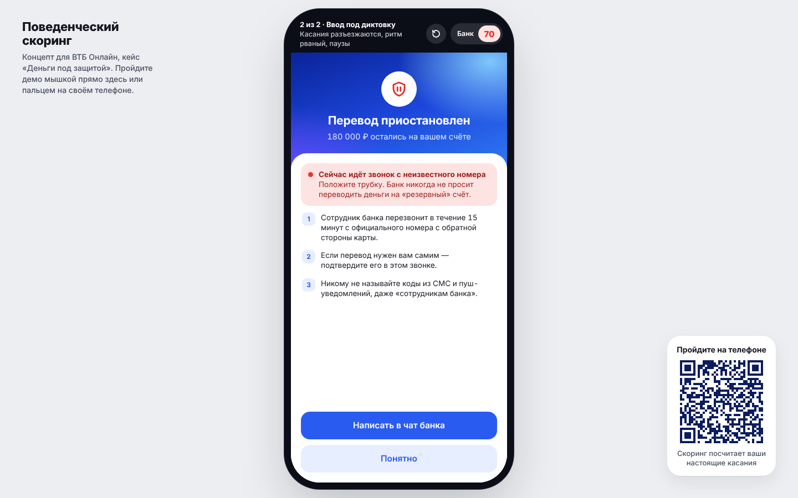
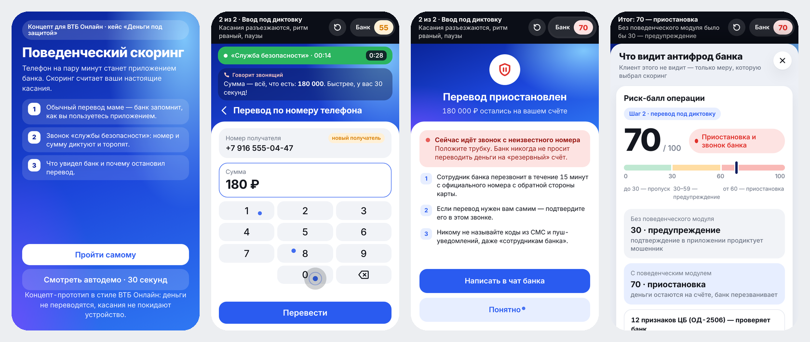

# Поведенческий скоринг клиента · MVP

Прототип модуля из нашего решения кейса «Деньги под защитой» (Changellenge Cup Moscow 2026, антифрод). Интерфейс — концепт в визуальном стиле ВТБ Онлайн: так модуль выглядел бы внутри приложения.

**Живое демо (одна ссылка для телефона и компьютера):** https://danindeedceo-eng.github.io/customer_behavioral_scoring/



## Как устроено демо

- **На телефоне** страница сама становится приложением банка на весь экран: человек проходит оба сценария пальцем, и скоринг считает его настоящие касания.
- **На компьютере** — тот же телефон по центру на нейтральном фоне, проходить можно мышкой. Справа внизу — QR, чтобы открыть демо на своём телефоне.
- Сверху тёмная полоска: какая сцена, что делать и живой риск-балл «Банк видит». По нажатию открывается разбор: что увидел антифрод, из чего сложился балл, касания, 12 признаков ЦБ и как устроен модуль.
- Кнопка «Смотреть автодемо» проигрывает оба сценария сама за 30 секунд.



## Что показывает демо

Социальная инженерия — главная дыра антифрода: клиент сам переводит деньги под давлением звонящего, а звонок банк не видит. Зато банк видит, **как клиент действует в приложении**. Спешка и работа «под диктовку» меняют поведение: точность попадания по кнопкам падает, нажатия становятся длиннее, ритм рваный, появляются паузы.

На экране телефона — что видит клиент; по кнопке «Банк видит» — что в этот момент видит антифрод банка.

1. **Обычный перевод маме.** «Платежи → Частые переводы → Мама», 1 500 ₽. Скоринг сравнивает касания с профилем клиента: отклонения нет — 0 баллов, перевод проходит. Этот перевод достраивает профиль до 10 сессий из 10.
2. **Звонок из «службы безопасности».** Клиента ведут по приложению голосом: «откройте перевод по номеру телефона», затем диктуют номер и сумму и торопят таймером. Касания разъезжаются, появляются паузы — **70 баллов, перевод приостановлен**: деньги остаются на счёте, приложение предупреждает, что идёт звонок с неизвестного номера, банк перезванивает. Без поведенческого модуля было бы 30 баллов и предупреждение, подтверждение которого мошенник просто продиктует.

Признаки считаются **по реальным касаниям** в браузере, без случайных чисел. Кнопка «Смотреть автодемо» проигрывает оба сценария сама.

## Три меры для клиента

| Балл | Что видит клиент |
|---|---|
| до 30 | перевод проходит |
| 30–59 | шторка «Проверьте перевод»: предупреждение о «резервном счёте», кнопки «Отменить перевод» и «Всё равно перевести» |
| от 60 | экран «Перевод приостановлен»: деньги остаются на счёте, предупреждение о звонке, банк перезванивает с официального номера |

Шторку 30–59 видно, если пройти шаг 2 самому и вводить номер и сумму спокойно: поведение в норме, остаются признак диктовки, новый получатель и крупная сумма — 45 баллов.

## Как считается балл

**Признаки сессии** (SDK считает их на устройстве, около 2 КБ агрегатов на сессию, сырые касания не хранятся):

| Признак | Как считается |
|---|---|
| Смещение от центра кнопки | среднее расстояние касания от центра кнопки, %: 0 — центр, 100 — край |
| Длительность нажатия | медиана, мс |
| Интервал между нажатиями | медиана интервалов до 1,5 с, мс |
| Неровность ритма | разброс интервалов / средний интервал |
| Паузы | число интервалов дольше 1,5 с |
| Звонок во время перевода | да / нет |

**Отклонение от профиля.** Профиль — медиана и разброс признаков по обычным сессиям клиента:

```
z_i = (признак_i сейчас − медиана_i в профиле) / разброс_i
сумма отклонений = Σ max(0; z_i − 1)
баллы поведения = 0, если сумма < 1,6;  иначе min(25; 10 + 3 × (сумма − 1,6))
```

Для длительности нажатия и интервала считается отклонение в любую сторону, для остальных признаков — только в сторону «хуже обычного».

**Балльный скоринг** (как в концепции):

| Сигнал | Баллы |
|---|---|
| Поведение: отклонение от профиля | +10…+25 |
| Признаки диктовки: звонок во время перевода или 2+ паузы | +15 |
| Новый получатель | +15 |
| Сумма больше половины от суммы с последними пятью переводами | +15 |
| Новое устройство | +20 |

**Решение по порогам:** до 30 — пропуск; 30–59 — предупреждение и подтверждение в приложении; от 60 — приостановка и звонок из банка.

12 признаков из приказа Банка России ОД-2506 (161-ФЗ) банк проверяет на каждом переводе у себя на сервере: база мошенников ЦБ, стоп-листы, данные операторов связи, история счёта. В телефоне этих данных нет, поэтому в демке признаки стоят на панели антифрода банка. Сработал любой — обязательная приостановка, в баллы они не входят. В сценарии с мошенником не срабатывает ни один: номер новый, в базах его ещё нет, — перевод останавливает поведенческий скоринг. Сам скоринг ничего не блокирует: это один сигнал в общем скоринге риска.

## Ограничения

- Веса и пороги стартовые и экспертные, как в концепции. В пилоте их подбирают на истории операций, потом заменяют моделью (логистическая регрессия, градиентный бустинг).
- В демо профиль строится по одному обычному переводу; в жизни — по 10 сессиям в приложении.
- Интерфейс — концепт в визуальном стиле ВТБ Онлайн, а не настоящее приложение: деньги не переводятся, данные не уходят из браузера.

## Как запустить

Открыть `index.html` в браузере (Chrome, Safari, Яндекс Браузер). Это один файл без зависимостей, из сети подгружается только шрифт Inter из Google Fonts.

Не открывайте файл в просмотрщике мессенджера (например, в Телеграме на iPhone): он не выполняет скрипты, и кнопки не нажимаются — страница сама об этом предупредит. Нужна ссылка в браузере.

Чтобы заработала ссылка на живое демо: **Settings → Pages → Build and deployment → Deploy from a branch → `main` / `(root)` → Save.** Через минуту-две демо откроется по адресу выше. Старая ссылка `/m/` переадресует на неё же.
